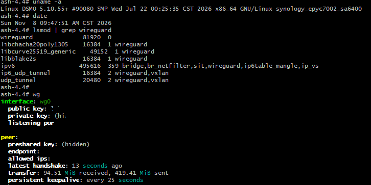

# WireGuard：epyc7002 / DSM 7.4

本分支记录为 SA6400（平台 `epyc7002`）构建 Linux 5.10 原生 WireGuard 套件的方法。仓库包含 `README.md`、`agent.md` 和经过隐私处理的效果图。代码下载、脚本修改、编译和打包由 AI 根据指南在独立工作目录完成。

## 构建与运行效果



图中可见 Linux 5.10.55+ 环境下 WireGuard 及加密依赖模块已经加载，wg0 接口存在，`wg` 输出显示最近握手与收发流量。这是本次构建后的运行效果记录；不能据此证明长期稳定性、吞吐表现或安全性。

图片中的公钥、Peer 标识、Endpoint、监听端口与 AllowedIPs 已使用不透明黑色覆盖，并清除可见残边和图片元数据。私钥和预共享密钥原本显示为 `(hidden)`。图片保留了用于说明结果的内核、平台及握手信息。

自行构建的原因及安全免责声明见 [main 分支 README](https://github.com/flyinskyin2013/synology_wireguard/blob/main/README.md)。请自行审查协议、源码、依赖、构建过程及部署风险；作者不提供安全保证。

## 适用范围与验证状态

- 目标：DSM 7.4、epyc7002、Linux 5.10.55+。
- 曾完成原生模块和 SPK 构建，构建退出码为 0；包内包含用户态工具和加密依赖。
- 套件以 root 身份启动已有成功反馈，效果图显示握手与收发计数；吞吐、重启恢复、长期稳定性和其他设备兼容性需要另行验证。
- 已知验证环境的工具链标识为 7.4-90074，公开内核源码来自 7.4-90080。不能据此认定不同 DSM 构建号完全兼容。
- 模块版本标识曾为 `5.10.55+ SMP mod_unload`。相同 vermagic 也不能代替符号和实际加载验证。
- 本方案不支持旧的 `wireguard-linux-compat` 路径。

## 1. 交给 AI 的任务

让 AI 阅读 [agent.md](agent.md)，在本仓库以外完成实现。AI 应下载公开源码、固定实际使用的版本或提交、应用修改、构建并检查 SPK，记录结果。不得将源码、产物、密钥或运行环境信息加入本仓库。

## 2. 公开下载来源

| 用途 | 来源 |
| --- | --- |
| 原始套件工程 | [runfalk/synology-wireguard](https://github.com/runfalk/synology-wireguard) |
| 群晖构建框架 | [SynologyOpenSource/pkgscripts-ng](https://github.com/SynologyOpenSource/pkgscripts-ng)，使用 DSM7.4 分支 |
| 工具链 | [toolkit/7.4](https://archive.synology.com/download/ToolChain/toolkit/7.4) |
| 内核源码目录 | [Synology NAS GPL Source](https://archive.synology.com/download/ToolChain/Synology%20NAS%20GPL%20Source) |
| 已使用的内核源码 | [7.4-90080/epyc7002/linux-5.10.x.txz](https://global.synologydownload.com/download/ToolChain/Synology%20NAS%20GPL%20Source/7.4-90080/epyc7002/linux-5.10.x.txz) |
| 用户态工具 | [wireguard-tools](https://git.zx2c4.com/wireguard-tools/) |
| libmnl | [libmnl-1.0.5.tar.bz2](https://netfilter.org/projects/libmnl/files/libmnl-1.0.5.tar.bz2) |

Linux 内核源码是群晖定制版本。优先选择与实际 DSM 构建号对应的源码；对应版本缺失时说明差异并验证，不能静默替换。保留第三方许可证和来源记录。

## 3. 构建目录与代理

下列路径为通用示例：

```text
/work/wireguard-build/           # 独立工程工作目录
/work/wireguard-cache/
├── toolkit_tarballs/
├── pkgscripts-ng/
├── build_env/
├── kernel/linux-source/linux-5.10.x/
└── artifacts/
```

下载并解压内核源码到独立目录：

```bash
mkdir -p /work/wireguard-cache/kernel/linux-source
cd /work/wireguard-cache/kernel
wget -c 'https://global.synologydownload.com/download/ToolChain/Synology%20NAS%20GPL%20Source/7.4-90080/epyc7002/linux-5.10.x.txz'
tar -xJf linux-5.10.x.txz -C linux-source
find linux-source -path '*/drivers/net/wireguard/main.c'
```

需要代理时，在自己的终端设置 `http_proxy`、`https_proxy`。不要将真实代理写入文档或提交。代理必须可从容器网络访问；容器内的 localhost 指容器自身。先测试连接，再测试 GitHub、群晖完整工具链接口和文件下载。

## 4. 构建与缓存

AI 完成脚本修改后，镜像构建示例：

```bash
cd /work/wireguard-build
docker build --build-arg http_proxy --build-arg https_proxy -t synobuild .
```

运行示例：

```bash
mkdir -p /work/wireguard-cache/{toolkit_tarballs,pkgscripts-ng,build_env,artifacts}
docker run --rm --privileged \
  --env http_proxy --env https_proxy \
  --env PACKAGE_ARCH=epyc7002 --env DSM_VER=7.4 \
  -v /work/wireguard-cache/toolkit_tarballs:/toolkit_tarballs \
  -v /work/wireguard-cache/pkgscripts-ng:/pkgscripts-ng \
  -v /work/wireguard-cache/build_env:/build_env \
  -v /work/wireguard-cache/kernel:/kernel:ro \
  -v /work/wireguard-cache/artifacts:/result_spk \
  synobuild
```

上述命令假定镜像实现了 agent.md 的约定，内核源码默认从 `/kernel/linux-source/linux-5.10.x` 读取。Docker CLI 从当前进程环境传递代理变量；通过 sudo 执行时需确保这些变量实际传入。

缓存应区分压缩包与完整部署环境。完整环境可跳过部署；不完整目录不能仅凭“存在”就复用。新容器仍可能更新构建框架。源码压缩包需单独缓存或预下载，不应声称它们自动随镜像持久化。

预期产物示例：

```text
artifacts/WireGuard-1.0.0/WireGuard-epyc7002-1.0.0.spk
```

版本和路径以实现结果为准。修改工程文件后重新构建镜像。

## 5. NAS 安装与 root 启动

在 NAS 上先核对：

```bash
uname -r
cat /etc.defaults/VERSION
```

上传安装包后，可通过套件中心安装，或在 NAS root 终端执行：

```bash
synopkg install /volume1/packages/WireGuard-epyc7002-1.0.0.spk
/bin/bash /var/packages/WireGuard/scripts/start
```

原始工程的 DSM 7 套件默认以 package 用户运行，加载内核模块需要 root。项目提供的 scripts/start 会修改套件运行身份并启动。使用 root 安装不等于套件运行时就是 root；升级或重新安装后应重新确认。

```bash
cat /var/packages/WireGuard/conf/privilege
lsmod | grep wireguard
```

配置应包含 `"run-as": "root"`。不要通过修改系统文件权限绕过问题。

## 6. 功能验证

在 NAS root 终端创建临时接口，不配置路由：

```bash
ip link add wg-test type wireguard
ip link show wg-test
ip link delete wg-test
/var/packages/WireGuard/target/wireguard/wg --version
```

先确认 wg-test 未被使用。随后按自己的网络需求配置隧道，使用 `wg show` 检查握手和传输计数，并测试对端隧道地址。真实私钥、预共享密钥及配置文件不得提交。

## 7. 已遇到的问题

| 错误 | 处理 |
| --- | --- |
| x86_64 is not available platform | 使用平台名 epyc7002 |
| epyc7002 不在可用列表 | 确认 DSM7.4 分支和目标版本配置 |
| chroot 内找不到 wget | 外层提前下载并验证源码包 |
| libmnl 版本为空 | 不依赖目录页抓取，使用明确版本 |
| 缺少 lbzip2 | 镜像安装 bzip2、lbzip2 |
| Invalid cross-device link | 同时处理 BuildEnv.py 和 link_project.py 的硬链接逻辑 |
| compat 提示 Linux >= 5.6 | 替换为原生 5.10 源码 |
| 加密符号 undefined | 同时编译所需 lib/crypto 模块 |
| 安装阶段 KSRC 为空 | 安装使用编译产物，不强制重编模块 |
| iptables_modules_list: Permission denied | 使用项目 root 启动入口 |
| Invalid module format / Unknown symbol | 检查内核、符号和依赖，读取 dmesg |
| logs.install 不存在 | 优先检查构建阶段首个错误 |

诊断命令：

```bash
dmesg | tail -80
tail -80 /var/log/packages/WireGuard.log
```

发布诊断信息前移除地址、设备标识和密钥。本仓库不保存实际运行日志。

## 许可证

SPDX-License-Identifier: GPL-3.0-only

本仓库中由作者原创且有权授权的文档、说明及效果图贡献，采用 GNU General Public License 第 3 版（仅第 3 版）。完整英文条款见 [LICENSE](LICENSE)，官方说明见 [GNU GPL v3](https://www.gnu.org/licenses/gpl-3.0.html)。中文说明与协议正文存在差异时，以协议正文为准。

第三方源码、依赖、商标及其他第三方内容不因本声明而被重新授权，仍适用各自许可证和权利声明。链接某个项目不表示该项目采用 GPL-3.0。未来分发源码、修改或二进制产物时，须逐项核对适用许可证，履行保留声明、提供对应源码等实际适用的义务。

GPL 的无担保和责任限制以其正文和适用法律为准。许可证不构成安全保证，也不能自动消除法律责任；本仓库的安全声明与免责声明不得削减 GPL 赋予接收者的权利或附加与 GPL 冲突的限制。


